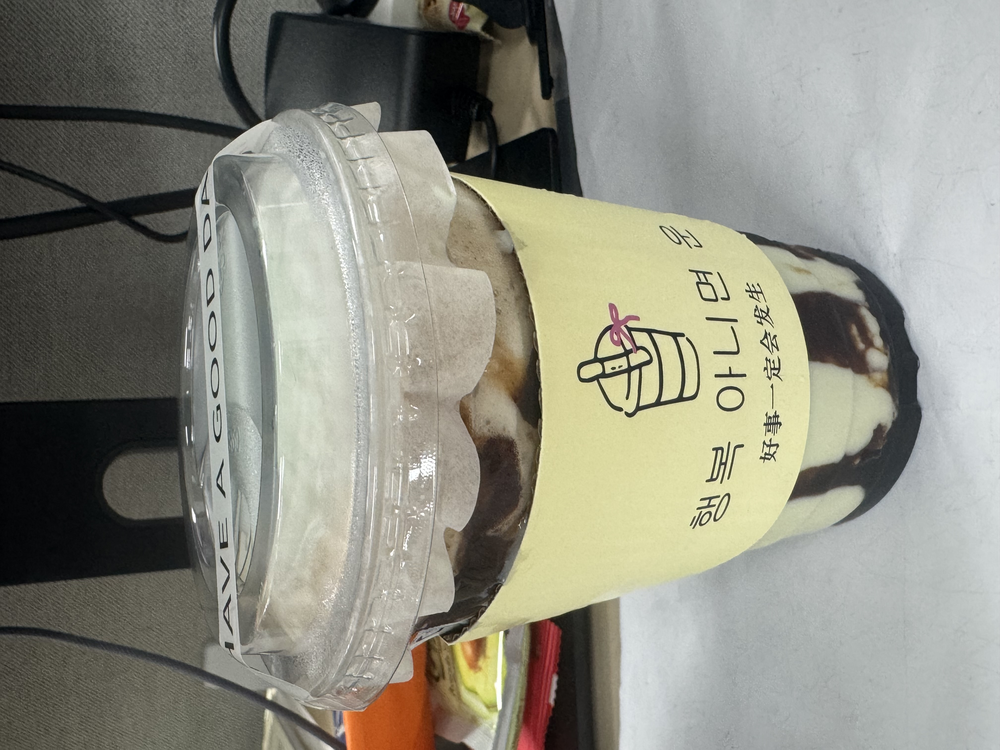

# 002 · 韩国冰奶·薄荷巧克力（少甜）

- **类别**：茶饮
- **记录日期**：2026-11-04（实际饮用日期未另行注明）
- **品牌 / 店铺**：韩国冰奶
- **点单甜度**：少甜
- **甜度感受**：齁甜
- **味道特点**：没有一点巧克力的感觉，就是糖浆的甜感
- **规格 / 价格**：未记录

## 当时的原话

> 韩国冰奶的薄荷巧克力少甜，齁甜，没有一点巧克力的感觉，就是糖浆的甜感。

## 给下次的自己

已经选了少甜，喝起来还是齁甜；没有感受到巧克力，记住的是糖浆的甜感。

