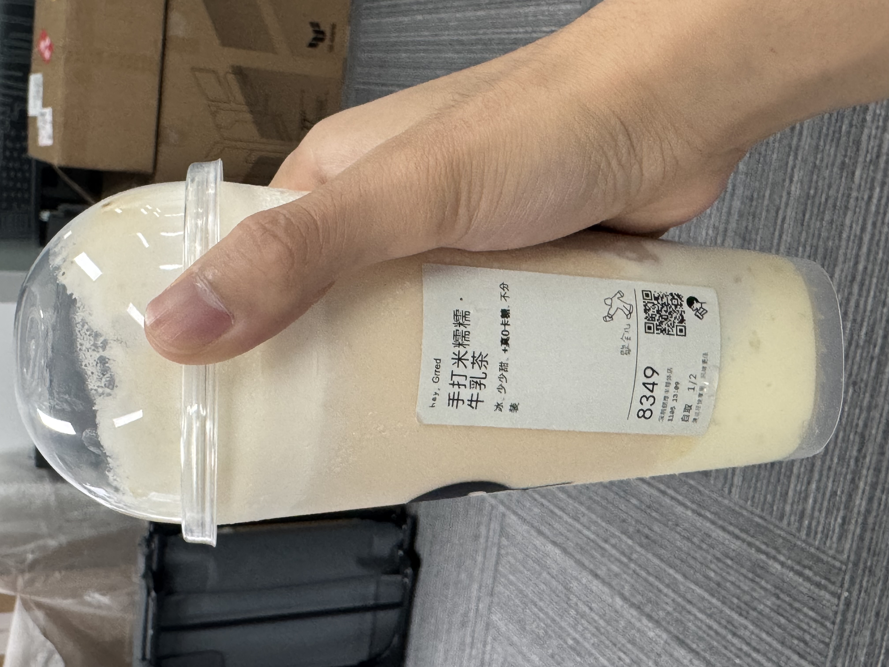

# 003 · 手打米糯糯牛乳茶（少少甜）

- **类别**：茶饮
- **记录日期**：2026-11-05
- **品牌 / 店铺**：喜茶
- **点单甜度**：少少甜
- **照片标签**：冰、少少甜、真0卡糖、不分装
- **甜度感受**：少少甜仍有点甜
- **味道特点**：好喝；吃东西的感觉没有芒果糯米饭爽，甜茶配甜的芋泥麻薯，让甜味更明显
- **规格 / 价格**：未记录；已喝完整杯，杯型待确认
- **热量**：待确认（未知，不按零计；未找到该款、该配置的可靠热量，真0卡糖不代表整杯零热量）

## 当时的原话

> 好喝
> 但是还是有点甜
> 已经选了少少甜了
> 吃东西的感觉没有芒果糯米饭爽
> 而且因为茶是甜的、芋泥麻薯也是甜的
> 喝甜的吃甜的就让甜味比较明显

饮用量补充原话：

> 整杯！

## 给下次的自己

好喝，但少少甜仍偏甜；甜茶与甜芋泥麻薯叠加，甜味更明显。想要吃糯米甜品的满足感时，记得这次感觉没有芒果糯米饭爽。下次点单前重读这条。

## 饮食日历

[查看 2026-11-05 的饮食记录](../calendar/?date=2026-11-05)。热量只在饮食日历记一次，点评不额外累计。

## 照片

[下载 HEIC 原照片](../photos/003-heytea-rice-milk-tea.HEIC)（原文件保留，JPEG 为网页兼容预览）。
